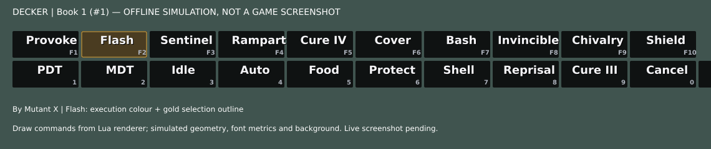

# Floating glass — v1.50.0-dev

Development candidate, 21 October 2026. Manual install; no stable release or updater-channel promotion.

## Baseline and scope

Based on `dev/decker-v1.49.5-integration` at `3e50a94ff027fd1ac73f283fe0d5033f9a122b61` (v1.49.6-dev). Main remained v1.47 plus documentation. PR #1 is the existing draft integration; issue #3 tracks live release readiness. The baseline has recorded offline tests, but no repository evidence proving v1.49.6 in Ashita/Vanacor. The user's previously observed working interface is the layout reference; no concept-image redesign was used.

The same two ten-button loops, dimensions, input handlers, native execution, profiles, navigation and auto-hide remain. Native ImGui buttons retain IDs and mouse hit testing. The new display helpers use the existing renderer. No packet, automation, execution or updater protocol changes.

## Appearance and settings

- Borderless black window, borderless dark buttons, muted attribution, DECKER and book/set/navigation heading.
- Outer background 5%, panel 15%, buttons 85%; StateBar background 15% for new profiles. Four backgrounds can reach 0–100%. Text stays opaque.
- Existing profiles retain their other preferences and saved StateBar opacity. The legacy `opacity` field is retained for backward compatibility but no longer multiplies text alpha. New fields: `outeropacity`, `panelopacity`, `buttonopacity`, `macrofont`, `macrofontsize`.
- Arial Bold, default 18 px, configurable 10–28 px and scaled with HUD. Segoe UI Bold, Times New Roman Bold and host Default are selectable. Font names use underscores in config files.
- Load at most three installed Windows fonts once at addon load. Font choice/size changes do not rebuild the atlas during a render frame. Missing files or APIs use the host default; Appearance reports availability. No font binaries are redistributed. Bundled fonts could use the same loader later with an appropriate redistribution licence; this pass uses installed fonts only.
- Macro names are centred in the name area; small muted shortcuts sit bottom-right. Oversized names shrink to a minimum then use ellipsis; the full name is available on hover where supported. No spell graphics.
- Last successful local dispatch keeps a coloured fill; arrow selection has a separate gold outline. Both can appear together. Neither proves that the server completed the macro. Existing cooldown red text and short press feedback remain.
- StateBar retains State/Utility semantics, independent persistent selection, layout, settings and command routes. Its opacity affects background, not text. Its ordinary buttons use dark glass; active states retain their existing theme colour.
- Subtle button shading uses the optional draw-list gradient API. Font/position/draw overload differences still need live checks. If the custom draw path throws, it disables itself and subsequent buttons/frames use ordinary labelled ImGui buttons. This fallback preserves operation but does not promise identical typography or key placement.

## Install

Back up `addons/decker` and character `.cfg` files. Unload Decker, extract the ZIP into the Ashita/Vanacor root so `addons/decker/decker.lua` is replaced, then load Decker. Connect and renew keyboard consent as usual. Open Appearance to adjust backgrounds and fonts. Restoring Appearance defaults does not reset controls or StateBar preferences.

This candidate is a manual ZIP. Existing updater channel pins remain unchanged; checking that channel may report the earlier candidate. Do not install an older candidate over this build unless deliberately rolling back.

## Verification completed

22 host-mocked regression groups passed in the available **Lua 5.4 shared-library runtime**, using `python3 tests/run_lua54.py`. The adapter supplies Lua 5.1-style `loadstring` and `os.execute` return conventions. LuaJIT was unavailable in this workspace; **these are not LuaJIT or in-game results**. The suite remains runnable with `luajit tests/regression.lua .` on a suitable host.

Coverage: per-character load/save/reset and isolation; all three mapping layouts; State/Utility dispatch, command allowlist and collision gates; held-key release; UI style stacks; updater validation/backup/rollback mocks; new opacity/font round trips; selection versus execution; custom draw calls; mouse, Enter and direct-key execution routes; long-name bounds; vector representations; unsupported draw fallback; collapsed windows and auto-hide recovery tab. ZIP integrity, expected content, source byte equality and SHA-256 were checked separately.

The image replays draw commands collected from the Lua row renderer with **simulated layout, font measurements and background**. It is not a screenshot from Ashita/Vanacor and does not establish live appearance. It illustrates Flash with execution fill and selection outline together. StateBar and surrounding live controls are not represented in this cropped row simulation.

## Live verification still required

1. Load in Ashita v4 and Vanacor. Confirm font loading, draw overloads, text baseline, gradients, bottom-right keys, long names and a bright/dark game background at your resolution.
2. Confirm both rows, book/set changes, locks and unlocked window dragging (including host title-bar-only drag preferences). The heading replaces the native title bar; no explicit position restore was introduced.
3. Click Flash, move selection to another button: Flash stays coloured. Execute the new selection: colour moves. Verify that selection and execution can overlap, and that the game receives each action once.
4. Test State/Utility, horizontal/vertical StateBar, persistent state colours and independent HUD selection. Check all four opacity controls at 0%, default and 100%.
5. Test navigation hold/toggle, key releases, 2/5-second auto-hide and recovery, settings visibility, then character switch and restart. Verify existing per-character settings and no cross-character leakage.
6. Inspect Settings readability and font fallbacks on hosts with missing fonts/APIs. Capture actual screenshots before considering stable acceptance.

## Reference inspection and licences

Read actual rendering/font/theme source, not just repository descriptions:

| Reference | Inspected commit | Lessons used |
| --- | --- | --- |
| [YunaUI](https://github.com/YunasXI/yunaui) | `9e587036b20b96e4284686214eb7dbf375085dd0` | Draw-list shapes/text, soft shading, cached fonts, compatibility differences |
| [XIUI](https://github.com/tirem/XIUI) | `4493ec0963abadf69a0c7d9a9d76e3ce4e45c90a` | Installed Windows font mapping, font atlas lifetime, measurement and explicit-font draw calls |
| [RoE Helper](https://github.com/AdamantKing/roe-helper) | `f2afc2d86c56f44aad6289f828437eddd8eba33e` | Scoped styles, separate background/text alpha, quiet headings |

YunaUI and XIUI carry GPLv3; RoE Helper carries MIT. No source or assets were copied or bundled. The implementation uses independently written display helpers and the existing Ashita ImGui API. Decker's existing Apache-2.0 LICENSE and NOTICE remain.
